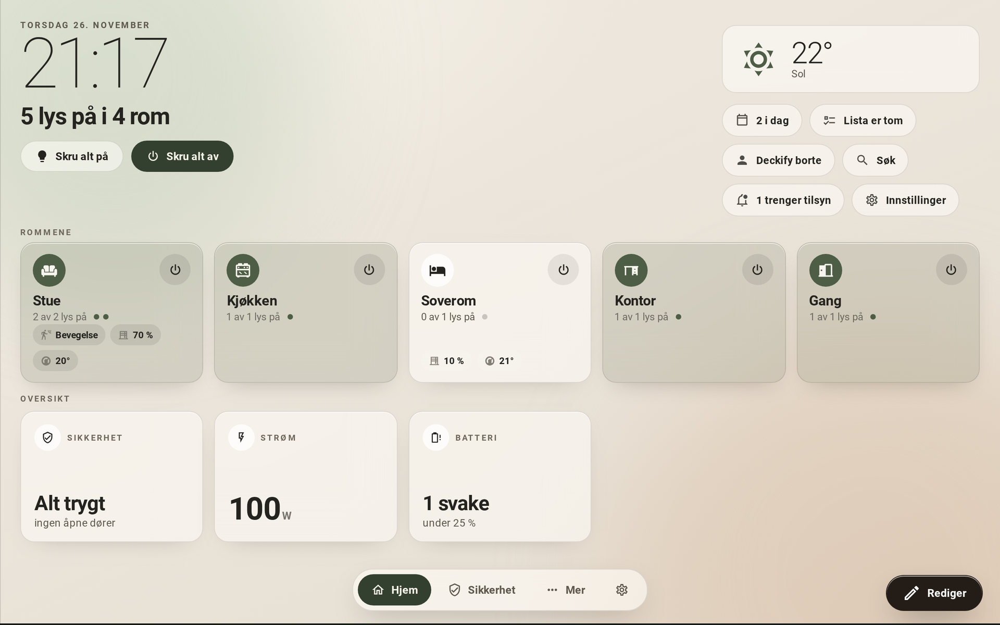
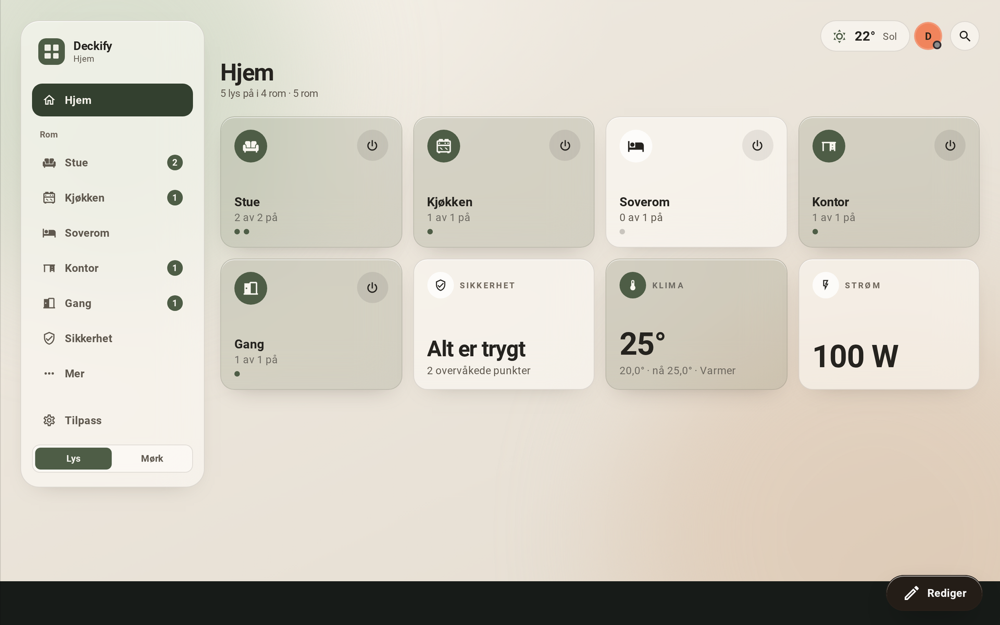
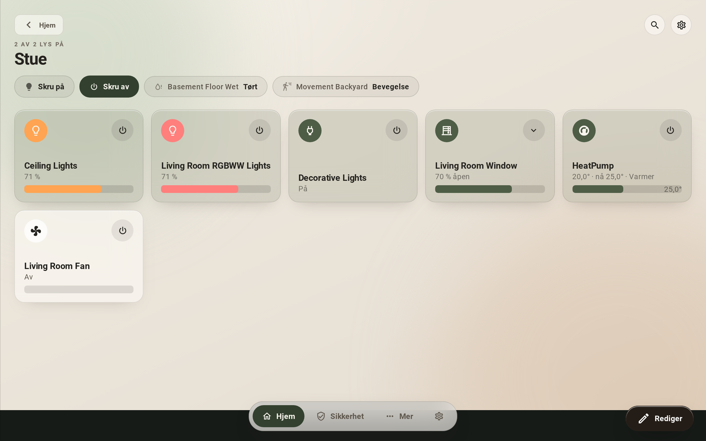
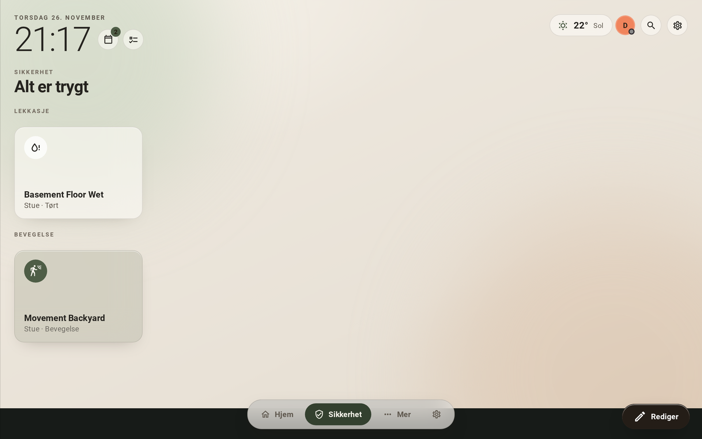
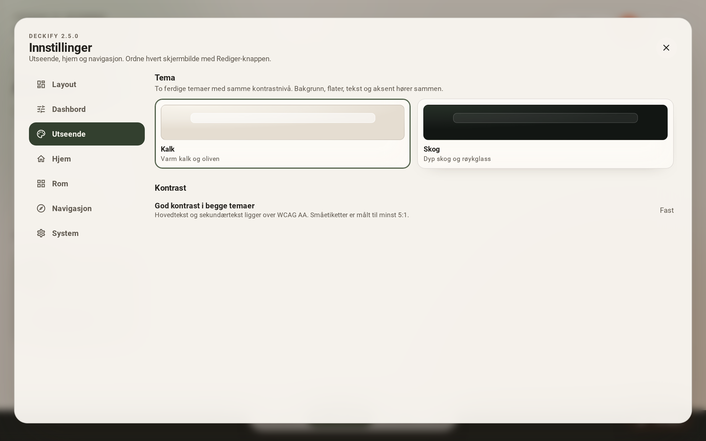
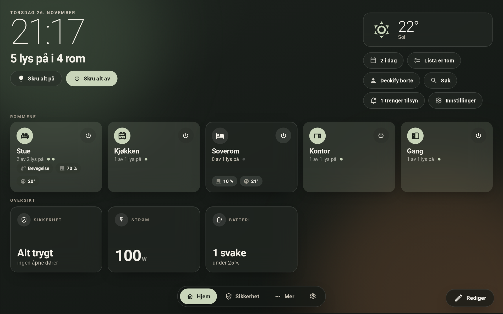

# Deckify

A full-screen Home Assistant dashboard that builds itself — delivered as an
**integration**, not just a card.

Deckify discovers your areas, devices, entities, scenes, plants, appliances,
power meter, energy price, weather, calendars and to-dos from Home Assistant.
A new dashboard starts intentionally empty; you decide whether Deckify should
fill it automatically or whether you want to build it yourself.

Built for **landscape wall tablets**, but it works on phones and desktops too.

[](https://github.com/matskkolstad/deckify/actions/workflows/validate.yml)
[](https://hacs.xyz)
[](LICENSE)



## Highlights

- **Multiple dashboards.** Add the integration again to get another dashboard
  with its own sidebar entry, rooms and layout.
- **Nothing is hardcoded.** Rooms, devices, scenes, plants, appliances, power,
  price, weather, calendars and to-dos are discovered from Home Assistant.
  Rename a scene in Hue and Deckify follows.
- **Empty by default.** A new dashboard is blank on purpose. Turn on
  *Behaviour → Fill the dashboard automatically* if you want it to fill
  itself, or add rooms, system cards and devices yourself.
- **Shared or per-screen layouts.** By default the layout and theme are stored
  on the server and shared by every screen. Enable *Per-screen layout* to give
  the tablet, phone and desktop their own order, hidden cards and theme.
- **Per-card settings.** Size (1×1, 2×1, 1×2, 2×2), info text, tap / hold /
  double-tap actions (toggle, detail panel, HA more-info, run scene, navigate,
  call a service), custom name, icon, colour and confirmation before acting.
- **Two layouts:** Startskjerm for the quick overview, and Oversikt with a
  permanent sidebar for controlling a lot.
- **Navigation:** Home, Rooms, Security and More. Media, Energy, House and
  Needs attention live under More.
- **Two themes:** Kalk, a warm limewash light theme, and Skog, a deep forest
  dark theme. Both use glass surfaces with readable, solid text.
- **Tablet and kiosk friendly.** Hide the Home Assistant sidebar, use a
  screensaver with a large clock, and keep the dashboard on a wall tablet.
- **Drag-and-drop editing** that works with a finger, a detail panel per
  domain, a weather forecast with Open-Meteo fallback, calendar, to-dos,
  global search, a media browser with speaker grouping, and Apple TV remote
  support.

## Screenshots

| Startskjerm · Kalk | Oversikt · Kalk |
|---|---|
|  |  |

| Room | Security |
|---|---|
|  |  |

| Settings | Startskjerm · Skog |
|---|---|
|  |  |

The screenshots use Norwegian UI text because the frontend is currently
Norwegian. English UI localization is planned separately from this
documentation.

## Documentation

| Page | Contents |
|---|---|
| [Getting started](docs/getting-started.md) | Install, add a dashboard and build the first screen. |
| [Configuration](docs/configuration.md) | Integration options, dashboard settings and per-card actions. |
| [Tablet and kiosk](docs/tablet-kiosk.md) | Landscape setup, kiosk browsers, screensaver and soak testing. |
| [Lovelace card](docs/lovelace-card.md) | Use Deckify as a card in an existing dashboard. |
| [Privacy](docs/privacy.md) | Storage, permissions and the Open-Meteo fallback. |
| [Troubleshooting](docs/troubleshooting.md) | Blank panel, cached modules, missing entities and reset. |
| [Development](docs/development.md) | Architecture, build, tests and release checklist. |

The [documentation index](docs/README.md) has the same list.

## Installation

Requires **Home Assistant 2024.7** or newer.

### HACS (recommended)

1. HACS → ⋮ → **Custom repositories** → add this repository as an
   **Integration**.
2. Search for **Deckify**, install it, and **restart Home Assistant**.
3. Go to **Settings → Devices & services → Add integration → Deckify**.

### Manual

Copy `custom_components/deckify/` to `/config/custom_components/` and restart
Home Assistant.

You do **not** need to register a Lovelace resource. The integration serves
its frontend files from `/deckify_files/` and registers the card for all
dashboards.

## First run

When you add the integration you choose a name, URL path, sidebar icon and
which areas the dashboard should cover. Leave areas empty to include all
areas, including new ones added later.

A new dashboard is empty by default and shows a **Get started** panel:

- **Fill automatically** imports every discovered room, card and entity.
- **Build it yourself** opens edit mode with an empty canvas.

You can change the choice later under **Settings → Behaviour**.

## How it works

- **One dashboard = one config entry.** Each entry gets its own sidebar item.
- **Areas are the backbone.** Every area becomes a room card and a room page.
- **The server stores the layout.** Order, hidden cards, card settings, filters
  and sensor bindings live in Home Assistant, so every screen sees the same
  dashboard by default.
- **Device choices stay local.** Layout, kiosk options and the screensaver are
  stored in the browser and can differ between screens.
- **Auto-fill is optional.** With it off, new entities never appear
  uninvited; you add them from the device picker.

## Configuration

The integration options and the in-dashboard settings write to the same
server-side configuration. The integration options are best for global setup;
the dashboard settings are best for everyday changes.

| Page | What it controls |
|---|---|
| **General** | Name, icon, sidebar visibility, admin-only access |
| **Behaviour** | Auto-fill and per-screen layouts |
| **Areas** | Which Home Assistant areas are included |
| **Devices** | Hidden entities, switches treated as lights, confirmation rules |
| **Sensors** | Override weather, power, price, outdoor temperature, to-dos, … |
| **Pages** | Extra pages under More |
| **Scenes** | Pinned scenes, maximum count, short names |
| **Advanced filters** | Ignored integrations, regex filters, battery warning |
| **Reset layout** | Reset order, hidden cards, sizes, groups and card settings |

See [Configuration](docs/configuration.md) for the full reference.

## Tablet and kiosk

Use a landscape tablet, open the Deckify panel and hide the Home Assistant
sidebar under **Settings → Navigation → Hide Home Assistant sidebar**. The
sidebar is restored when you leave Deckify.

The screensaver starts after 5 minutes by default, only in the panel (not in
a normal Lovelace card), and shows a large clock with optional weather, home
status, now-playing media and the next calendar event. Smoke, gas, carbon
monoxide, leaks and open doors are always shown.

See [Tablet and kiosk setup](docs/tablet-kiosk.md) for Fully Kiosk Browser,
start URLs, screensaver timing and a 24-hour soak-test checklist.

## Lovelace card

The same dashboard can be used as a card in any Lovelace dashboard:

```yaml
type: custom:deckify-card
dashboard: deckify
```

`dashboard` is the URL path of the Deckify dashboard, without a leading
slash. Without it, the card runs on defaults and stores its settings locally.

See [Lovelace card](docs/lovelace-card.md) for details.

## Privacy

Deckify stores its configuration inside Home Assistant. It has no telemetry
and no cloud account. When the configured weather entity is missing or
unavailable, Deckify can use Open-Meteo as a fallback, which sends the home
coordinates from Home Assistant to `api.open-meteo.com`.

See [Privacy](docs/privacy.md).

## Troubleshooting

Start with [Troubleshooting](docs/troubleshooting.md). The most common causes
of a blank panel are an outdated cached frontend module, a mixed `?v=` after
an update, or a missing integration entry.

## Development

There is no build chain: `src/` contains plain ES modules and
`tools/build.py` copies them to `custom_components/deckify/www/`.

```bash
python3 tools/bump.py 2.4.3
python3 tools/check_imports.py
python3 -m unittest discover -s tests -p "test_*.py"
bash tools/mirror.sh
cp tests/fixtures/snapshot.json tools/.chk/snapshot.json
node --test tests/*.test.mjs
node tools/.chk/render.mjs
python3 tools/build.py
```

The `?v=` query string is part of every module URL and must be bumped in all
files at once. Two different `?v=` values are two different modules to the
browser; a file that still loads an old `core.js` fails with
“does not provide an export named …”.

See [Development](docs/development.md) for architecture, tests, the render
harness and the release checklist.

## Credits

Inspired by [homedeck.pro](https://homedeck.pro). No code from it is used;
Deckify is written from scratch and is not affiliated with it.

The Figtree font is licensed under the SIL Open Font License.

## License

MIT. See [LICENSE](LICENSE).
