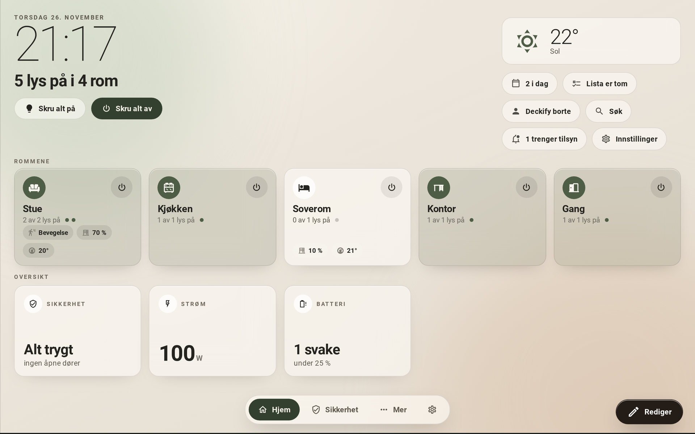

# Tablet and kiosk setup

Deckify is designed for a **landscape wall tablet**. A 1280×800 or larger
screen gives both Startskjerm and Oversikt room to breathe; 1920×1200 is even
better.

## Recommended setup

1. Add a Deckify dashboard and enable auto-fill, or build the layout manually.
2. Open the panel at `http://<home-assistant>:8123/<url-path>` — for example
   `/deckify`.
3. Open **Settings → Layout** and choose **Startskjerm** or **Oversikt**.
4. Open **Settings → Navigation**:
   - enable **Hide Home Assistant sidebar**
   - optionally enable **Hide Home Assistant top bar**
   - choose a screensaver delay
5. Open **Settings → Appearance** and choose **Kalk** or **Skog** for the
   room.
6. Arrange the dashboard once, then use the tablet in kiosk mode.

The sidebar/top-bar choices are scoped to the Deckify card: they are removed
when you leave Deckify, so they do not leave Home Assistant's own dashboard
without a sidebar.

## Kiosk browsers

Deckify works in a normal browser, the Home Assistant companion app, and
kiosk browsers such as Fully Kiosk Browser.

Typical kiosk-browser settings:

- Start URL: `http://<home-assistant>:8123/deckify`
- Landscape orientation lock
- Keep the screen awake
- Reload on reconnect or after the screen wakes
- Disable the browser's own screensaver if you use Deckify's, or the other
  way around. Two screensavers at once is confusing.
- Allow JavaScript and local storage; Deckify keeps device choices there.

The exact menu names differ between apps. The important part is that the
tablet opens the Deckify URL directly in landscape and stays awake.

## Screensaver

The screensaver is **off in a normal Lovelace card** and only runs in the
Deckify panel. Default delay is **5 minutes**; options range from 30 seconds to
30 minutes, or off.

It shows:

- a large clock and today's date
- optional weather and home status
- optional now-playing media and the next calendar event
- smoke, gas, carbon monoxide, leak and open-door alerts — always visible

Tap, key or swipe to wake it. The clock drifts slowly to reduce burn-in on a
screen that stays on all day.

If you use Fully Kiosk's own screensaver or motion detection, turn Deckify's
screensaver off to avoid double behavior.

## Touch behaviour

- Tap a card to toggle or open its default action.
- Long-press a card for the detail panel.
- Drag the handle on a card in edit mode to reorder it.
- Use the room list in Oversikt, or the room cards in Startskjerm, to move
  between rooms.
- Use **Escape** to close sheets if a keyboard is connected.

## 24-hour soak test

Before mounting the tablet, leave it running for a day and check:

- [ ] No horizontal scrolling at the tablet's real landscape resolution.
- [ ] The dock and edit button stay inside the screen.
- [ ] The screensaver starts after the chosen delay and wakes on touch.
- [ ] A Home Assistant restart reconnects without a manual reload.
- [ ] Wi-Fi loss and reconnect do not leave a stale dashboard.
- [ ] The dashboard still shows fresh states after 24 hours.
- [ ] Memory usage is stable in the browser's task manager.
- [ ] A Deckify update is picked up after a reload.

If you update Deckify while the tablet is open, reload the panel once. The
`?v=` cache-buster prevents mixed module versions, but an already loaded page
keeps its current modules until it is reloaded.

## Troubleshooting on a tablet

- **Sidebar/top bar does not hide:** make sure you are in the panel, not the
  Lovelace card, and that the option was saved for this device.
- **Screensaver never starts:** it only runs in the panel; check the delay and
  that the browser tab is visible.
- **Layout looks cramped:** use Startskjerm on a small tablet, or reduce card
  sizes. Oversikt is intended for wider screens.
- **Touch drag feels unreliable:** use the drag handle in edit mode; a swipe
  on the card itself is reserved for scrolling.
- **Old design after an update:** hard-refresh the page once.

See [Troubleshooting](troubleshooting.md) for general issues.
