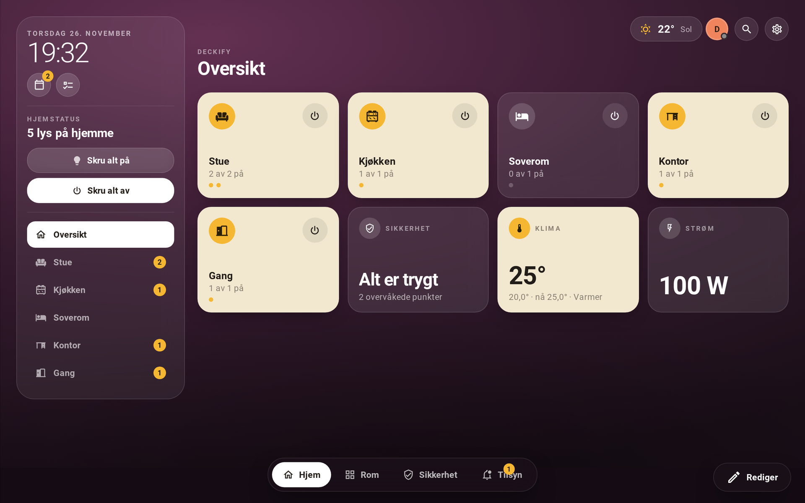

# Deckify

A full-screen Home Assistant dashboard that builds itself — as an integration,
not just a card.

- Multiple dashboards, each with its own sidebar entry
- Discovers rooms, devices, scenes, plants, appliances, power, price, weather
  and calendars automatically
- Empty from the start — you decide what it should show
- A shared layout for every screen, or a separate layout per device
- Per-card settings: size, info, actions, name, icon and colour
- Five layouts, seven pages, and drag-and-drop editing that works with a
  finger
- Editable quick tiles: your own buttons at the top of Home and each room
- A screensaver with a large clock and date, in your own theme

After installation, restart Home Assistant and add **Deckify** under
Settings → Devices & services.

